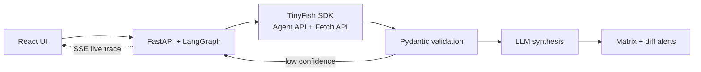

# nexus-agent.github.io
# Nexus Agent

**Autonomous competitive intelligence: days of market research in minutes.**
Built for Kritical Hacks 2026 (IGDTUW Delhi) · AI/ML Track · Powered by TinyFish Agent API + Fetch API.

Input a market or competitor list and a goal ("compare pricing at 50 seats"). Nexus deploys goal-driven agents that navigate JavaScript-heavy sites, interact with pricing calculators, extract typed schemas, and return a cited comparison matrix.

## Problem
Competitive research is a manual, multi-day loop: 20+ tabs per competitor, pricing hidden behind toggles, sliders and bot walls, and a hand-typed spreadsheet that is stale on arrival. Selector-based scrapers break on every redeploy.

## Architecture

```
React UI  ->  FastAPI + LangGraph  ->  TinyFish SDK  ->  Pydantic validation  ->  LLM synthesis  ->  Matrix + Alerts
 (client)      (orchestration)       (Agent + Fetch)       (typed schemas)        (validated data)     (cited, diffed)
                     |                      ^                      |
                     +-- Redis queue (parallel fan-out)           +-- retry loop: low confidence -> refined goal
                     +-- Postgres (snapshots + diffs)                 agent failure -> Fetch API -> rule-based parser
                     +-- SSE stream: live agent steps -> UI
```



## TinyFish integration

| | Agent API | Fetch API |
|---|---|---|
| Used for | Anything a human must click | Anything a page simply says |
| Capabilities | Multi-step DOM actions: toggle monthly/annual, set seat sliders, fill calculator forms, paginate plan tables, dismiss modals | Renders JS pages to clean markdown/JSON |
| Targets | Pricing calculators, gated plan tables | Docs, changelogs, blogs, reviews |
| Role in fallback | Primary path for interactive pages | Deterministic fallback when an agent run fails |

A router sends interactive pages to the Agent API and static content to the Fetch API (cheaper, faster).

**Why not Selenium/Playwright?** Brittle selectors break on every redeploy, we would own proxies, stealth and bot-protection handling, and every competitor needs its own script. TinyFish takes plain-English goals instead.

## Role of AI
Planner LLM (goal decomposition) -> TinyFish agents (action) -> verifier loop (schema + confidence + cross-source checks) -> synthesis LLM that only reads validated data.

## Roadmap
- **Now:** on-demand cited matrices
- **Next:** scheduled monitors, Slack/email alerts, Sheets/Notion/CRM export
- **Later:** self-healing goals, vertical packs (SaaS, fintech, e-commerce), public API

## Status
Hackathon build in progress. See the pitch deck for scope and feasibility.
